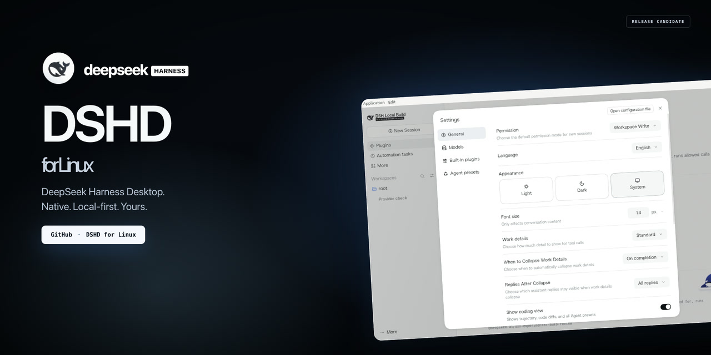

# DSHD for Linux

> DSHD stands for **DeepSeek Harness Desktop**.

English | [简体中文](README.zh-CN.md)



[](https://github.com/openviewmobile/dshd-linux/actions/workflows/ci.yml)
[](https://github.com/openviewmobile/dshd-linux/releases)

A standalone Linux desktop distribution project for DeepSeek Harness. It adds
Linux x86_64/aarch64 targets to the official desktop application and provides
reproducible packaging, smoke tests, acceptance evidence, and signed release
artifacts.

> This is a packaging and distribution repository, not the upstream application
> source tree. The desktop runtime is bundled from the upstream release.

## Download

Prebuilt AppImage, deb, rpm and Flatpak packages are published on the
[GitHub Releases page](https://github.com/openviewmobile/dshd-linux/releases).
Choose the asset for your architecture:

| Format | x86_64 | aarch64 | Install |
|---|---|---|---|
| AppImage | yes | yes | `chmod +x` and run |
| deb | yes | yes | `sudo apt install ./<file>.deb` |
| rpm | yes | yes | `sudo dnf install ./<file>.rpm` |
| Flatpak | yes | yes | `flatpak install --user --bundle ./<file>.flatpak` |
| Arch/AUR | x86_64 | — | source recipe in `packaging/aur`; not a Release asset |

Every Release asset is accompanied by a detached `.asc` signature; each release
also has a signed `SHA256SUMS`. The CI release currently attaches the eight
primary-format packages; AUR and local Snap/OBS packaging remain in the
repository. If the latest Release page does not yet show
binary assets, use the **Build Linux release assets** GitHub Actions workflow
(or build from source below); the workflow is the supported release builder.

## APT and DNF repositories (x86_64)

GitHub Pages hosts signed APT and DNF repositories generated from the Release by
GitHub Actions:

<https://openviewmobile.github.io/dshd-linux/>

Debian / Ubuntu:

```bash
curl -fsSL https://openviewmobile.github.io/dshd-linux/key.asc \
  | sudo gpg --dearmor -o /usr/share/keyrings/dshd-linux.gpg
echo "deb [signed-by=/usr/share/keyrings/dshd-linux.gpg] https://openviewmobile.github.io/dshd-linux/apt stable main" \
  | sudo tee /etc/apt/sources.list.d/dshd-linux.list
sudo apt update
sudo apt install deepseek-harness
```

Fedora / RHEL / Rocky Linux:

```bash
sudo curl -fsSL https://openviewmobile.github.io/dshd-linux/dshd-linux.repo \
  -o /etc/yum.repos.d/dshd-linux.repo
sudo dnf install deepseek-harness
```

These repositories are **x86_64 only** and are hosted as static GitHub Pages
(under the 1 GB Pages limit). aarch64 users should use the `.deb`/`.rpm` Release
assets; AppImage and Flatpak remain direct Release downloads for all
architectures. The APT `InRelease` and DNF `repomd.xml.asc` are signed by the
release key.

## Supported Linux platforms and how to install

The packages bundle Electron, Node.js, Python and the application runtime. The
host only needs a glibc-based Linux desktop (glibc **2.32 or newer**) and the
architecture must be **x86_64** or **aarch64**.

The first four formats are attached to the CI Release. AUR, openSUSE, Nix and
Gentoo are source recipes in this repository, not binary Release assets.

| Distribution | Version | How to get it | Install command | Verification |
|---|---|---|---|---|
| Debian | 12, 13 | Release `.deb` (x64/arm64) or **APT repo** (x64) | `sudo apt install ./deepseek-harness-*.deb` | deb installed/launched in amd64 Docker + Xvfb; arm64 structure checked |
| Ubuntu | 22.04, 24.04 | Release `.deb` (x64/arm64) or **APT repo** (x64) | `sudo apt install ./deepseek-harness-*.deb` | x64 deb path verified; 24.04 t64 dependency names measured |
| Fedora | 41, 42 | Release `.rpm` (x86_64/aarch64) or **DNF repo** (x64) | `sudo dnf install ./deepseek-harness-*.rpm` | rpm metadata/unpack checked; full Fedora install still to verify |
| RHEL / Rocky Linux | 9 | Release `.rpm` (x86_64/aarch64) or **DNF repo** (x64) | `sudo dnf install ./deepseek-harness-*.rpm` | glibc baseline sufficient; install on target still to verify |
| Arch Linux / Manjaro | rolling | Source recipe: [`packaging/aur`](packaging/aur) (not yet published to AUR) | `cd packaging/aur && DSHD_APPIMAGE_X86_64=/path/to/dshd.AppImage makepkg -si` (or `pacman -U`) | x86_64 built, installed with `pacman -Udd`, launched under Xvfb |
| openSUSE Leap / Tumbleweed | 15.6 / current | No OBS repository yet. Release → `*-linux-x86_64-unsigned.rpm`, or build [`packaging/obs`](packaging/obs) | `sudo zypper install ./deepseek-harness-*.rpm` (not verified) | local `rpmbuild` only; OBS service build not done |
| NixOS | current | Source recipe: [`packaging/nix`](packaging/nix) (flake) | `cd packaging/nix && nix build .#default` | template/static checks only; not built on NixOS in the reference environment |
| Gentoo | current | Source recipe: [`packaging/gentoo`](packaging/gentoo) (local overlay) | Add the ebuild to a local overlay, then `emerge deepseek-harness-bin` | ebuild/static checks only; not built on Gentoo in the reference environment |
| Any glibc distribution (AppImage) | — | Release → `*.AppImage` | `chmod +x deepseek-harness-*.AppImage && ./deepseek-harness-*.AppImage` | AppImage launched under Xvfb on x86_64/aarch64 |
| Any glibc distribution (Flatpak) | — | Release → `*.flatpak` | `flatpak install --user --bundle ./deepseek-harness-*.flatpak` | Flatpak 25.08 x86_64/aarch64 installed and launched |
| Snap | — | Source recipe: [`packaging/snap`](packaging/snap) (PoC, not in Snap Store) | `snapcraft pack` | `.snap` assembled manually; no `snap install` verification |
| Alpine Linux | — | None | — | ❌ unsupported: musl/Electron incompatibility |

The CI Release currently contains **8 primary packages**: AppImage, deb, rpm and
Flatpak for x86_64 and aarch64. Snap, openSUSE OBS, AUR, Nix and Gentoo remain
source/packaging recipes until they are built and verified in their native
channels. `armv7`, 32-bit x86 and musl distributions are not supported.
Wayland-native sessions, tray icons and IME behavior still need verification on
physical desktops.

## Install and first run

```bash
# AppImage
chmod +x deepseek-harness-*.AppImage
./deepseek-harness-*.AppImage

# deb
sudo apt install ./deepseek-harness-*.deb

# rpm
sudo dnf install ./deepseek-harness-*.rpm

# Flatpak (runtime 25.08 required)
flatpak install flathub org.freedesktop.Platform//25.08   org.electronjs.Electron2.BaseApp//25.08
flatpak install --user --bundle ./deepseek-harness-*.flatpak
```

On first launch, choose **Add API Key** (or sign in if your provider supports
it), select a model, and start a session. The workspace, files and plugins are
local; the network is used only for the model endpoint. Office→PDF uses the
bundled LibreOfficeKit WASM engine, so system LibreOffice is not required.

Verify a download before installing:

```bash
gpg --import keys/deepseek-harness-release-signing.asc
gpg --verify SHA256SUMS.asc SHA256SUMS
sha256sum -c SHA256SUMS
```

## Open source used and acknowledgements

DSHD is a distribution layer. It bundles or builds on the following open-source
projects; their licenses remain in force. This table lists the major components,
not every transitive dependency. The full upstream notices ship in the packages
and in [NOTICE](NOTICE).

| Project | License | Role |
|---|---|---|
| [DeepSeek Harness](https://github.com/deepseek-ai/deepseek-harness) | MIT | Upstream desktop UI, Host, CLI and runtime |
| [Electron](https://www.electronjs.org/) | MIT | Desktop shell |
| [Chromium](https://www.chromium.org/) | BSD-3-Clause and third-party licenses | Renderer/runtime used by Electron |
| [Node.js](https://nodejs.org/) | MIT | Bundled JavaScript runtime |
| [pnpm](https://pnpm.io/) | MIT | Package manager and plugin installation |
| [Python](https://www.python.org/) | PSF-2.0 | Bundled runtime tooling |
| [ripgrep](https://github.com/BurntSushi/ripgrep) | MIT / Unlicense | Workspace search |
| [LibreOffice / LibreOfficeKit](https://www.libreoffice.org/) | MPL-2.0 | Office document conversion |
| [koffi](https://koffi.dev/) | MIT | Native FFI bindings |
| [sharp](https://sharp.pixelplumbing.com/) | Apache-2.0 | Image processing |
| [node-pty](https://github.com/microsoft/node-pty) | MIT | Terminal support |
| [electron-builder](https://www.electron.build/) | MIT | AppImage/deb/rpm/Flatpak packaging |
| [fpm](https://github.com/jordansissel/fpm) | MIT | deb/rpm construction |
| [Flatpak](https://flatpak.org/) / [flatpak-builder](https://github.com/flatpak/flatpak-builder) | LGPL-2.1+ / GPL-2.0+ | Sandboxed Flatpak bundle |
| [AppImage](https://appimage.org/) | MIT | Portable AppImage runtime |
| [Three.js](https://threejs.org/) | MIT | Promo video rendering |
| [Puppeteer](https://pptr.dev/) | Apache-2.0 | Promo frame capture |

Test fixtures from [Apache POI](https://poi.apache.org/) (Apache-2.0) are used
only in `evidence/legacy-office/` and are not shipped in the application.
Development and CI also use Docker, Xvfb, GitHub Actions and the distribution
packaging tools listed in [docs/distro-packages.md](docs/distro-packages.md).

**Thank you** to the DeepSeek Harness maintainers, the Electron/Chromium/Node.js
and pnpm communities, the LibreOffice and LibreOfficeKit teams, the Flatpak and
AppImage projects, and the Debian, Ubuntu, Fedora, RHEL/Rocky, Arch, openSUSE,
NixOS and Gentoo packagers and testers whose work makes this distribution
possible.

## Trademarks

DSHD is an independent Linux distribution project. It is not the upstream
DeepSeek Harness source tree and is not affiliated with or endorsed by DeepSeek.
DeepSeek and DeepSeek Harness are trademarks of their respective owners; no
trademark license is granted by this repository. See [NOTICE](NOTICE).

## What is in this repository

- Linux target patches in `patches/` (desktop target, deb/rpm/Flatpak, runtime
  mirrors, Flatpak launcher);
- AppImage, deb, rpm and Flatpak artifacts for x86_64 and aarch64;
- Arch/AUR, Snap, openSUSE OBS, Nix/NixOS and Gentoo packaging definitions in
  `packaging/`;
- Docker + Xvfb build and smoke scripts in `scripts/`;
- screen-by-screen acceptance evidence in `evidence/`;
- Apache-2.0 project license plus the upstream MIT notice, contributor and
  security guides, issue/PR templates, and CI;
- detached GPG signatures for every release artifact and checksum file.

## Repository layout

```
Dockerfile              build and test image
patches/                Linux target and packaging patches
scripts/                build, package, smoke, signing and verification
evidence/               Xvfb/GUI/artifact evidence
docs/                   design, acceptance, release and signing documentation
dist/                   local artifacts (gitignored)
```

## Project status

- AppImage, deb, rpm and Flatpak are built for **x86_64** and **aarch64**.
  AppImage, deb and Flatpak have launch verification; rpm has metadata and
  unpacking checks.
- Flatpak uses the supported **25.08** runtime and has x86_64/aarch64
  install/launch evidence.
- Arch/AUR `-bin` was built, installed and launched under Xvfb.
- Snap (manually assembled) and openSUSE OBS (local `rpmbuild`) are packaging
  artifacts, not Store/service-verified channels.
- Nix and Gentoo definitions are statically checked only.
- Every release artifact and checksum has a detached GPG signature; platform
  code signing and auto-update are not implemented in v1.
- Wayland, tray icons and IME behavior still need physical-desktop testing.

Per-channel details and evidence are in
[docs/distro-packaging-implementation.md](docs/distro-packaging-implementation.md),
[docs/distro-packages.md](docs/distro-packages.md) and
[docs/acceptance.md](docs/acceptance.md).

## Build from source

```bash
docker build -f Dockerfile -t dshd-linux-test .
docker volume create dshd-linux-src
docker run --rm -it -v "$PWD:/work" -v dshd-linux-src:/src dshd-linux-test
# Inside the container
/work/scripts/build-and-smoke.sh
```

Build the installable formats with `/work/scripts/package-formats.sh`. The
release workflow builds and signs packages on GitHub; do not upload locally
built binaries to the Release page. See
[docs/release.md](docs/release.md) for build details and
[docs/testing.md](docs/testing.md) for the verification matrix.

## Documentation

- [Documentation index](docs/README.md)
- [Architecture and patches](docs/architecture.md)
- [Acceptance record](docs/acceptance.md)
- [Release and signing](docs/release.md)
- [Distro package matrix](docs/distro-packages.md)
- [YouTube promo and thumbnail](promo/README.md)

## GitHub Actions release builds

Release packages are built on GitHub-hosted x86_64 and arm64 runners, not on a
maintainer workstation. Pushing a `v*` tag (or running the **Build Linux release
assets** workflow manually) builds AppImage, deb, rpm and Flatpak, signs the
combined checksums with the `GPG_PRIVATE_KEY` repository secret, and publishes a
pre-release. The workflow pins upstream commit
`fcc0ad462172522aaf5c93a7b2e01f6b9f0b0159` and uses the container in
[`Dockerfile`](Dockerfile).

## Docker tests

```bash
# From the repository root
docker build -f Dockerfile -t dshd-linux-test .
docker volume create dshd-linux-src

docker run --rm -it \
  -v "$PWD:/work" \
  -v dshd-linux-src:/src \
  dshd-linux-test
```

Inside the container:

```bash
/work/scripts/build-and-smoke.sh
```

> `/src` must be a Docker named volume. A macOS bind mount such as `/tmp` makes
> electron-builder fail with `EACCES: permission denied, chmod` when copying the
> Windows `node.cmd`.

The script:

1. clones/updates upstream into `/src`;
2. applies the patches;
3. runs `pnpm install`;
4. runs `pnpm --filter @deepseek-ai/dsh-desktop package:linux:arm64:dir`
   (or `linux-x64`);
5. launches `linux-arm64-unpacked/deepseek-harness --no-sandbox` under Xvfb;
6. captures a screenshot and checks the window/log.

Build deb/rpm/Flatpak (not the `--dir` smoke package):

```bash
/work/scripts/package-formats.sh
```

## Known risks

- The first `pnpm install` downloads Electron/Node/Python wheels and can take a
  long time.
- Electron inside Docker needs `--no-sandbox`; test use only.
- Linux auto-update and platform code signing are not implemented. Detached GPG
  signatures and `SHA256SUMS` are available; updates remain manual or use a
  custom updater.
- The upstream Desktop has Linux code paths but no official Linux release
  acceptance; each capability must be tested here.

## Promo video

A 50-second YouTube promo, thumbnail, subtitles and upload copy are in
[`promo/`](promo/README.md); the storyboard and render pipeline are documented
in [`docs/promo.md`](docs/promo.md). The video uses Three.js and deterministic
hyper-frame transitions rather than a screen recording.

## Verification and signing

```bash
gpg --import keys/deepseek-harness-release-signing.asc
scripts/verify-artifacts.sh
DSHD_GPG_KEY=0E6023DF4DB8C68AA2202EF876CE5675AFF067FF scripts/sign-artifacts.sh
```

`SHA256SUMS` and every artifact have detached `.asc` signatures. The public key
fingerprint is `0E6023DF4DB8C68AA2202EF876CE5675AFF067FF`; see
[docs/release-signing.md](docs/release-signing.md). The private key is not in the
repository; replace it with an offline, passphrase-protected key before a
production release. The `unsigned` filename suffix only means there is no
platform code-signing certificate; it does not mean the detached signature is
missing.

## License

Apache-2.0 for this repository. See [LICENSE](LICENSE) and [NOTICE](NOTICE).
Upstream DeepSeek Harness is MIT-licensed; the full upstream notice is in
[LICENSES/MIT-DeepSeek-Harness.txt](LICENSES/MIT-DeepSeek-Harness.txt).
Third-party components, including Electron, the bundled runtime,
LibreOfficeKit WASM and Apache POI test fixtures, remain under their respective
licenses.
